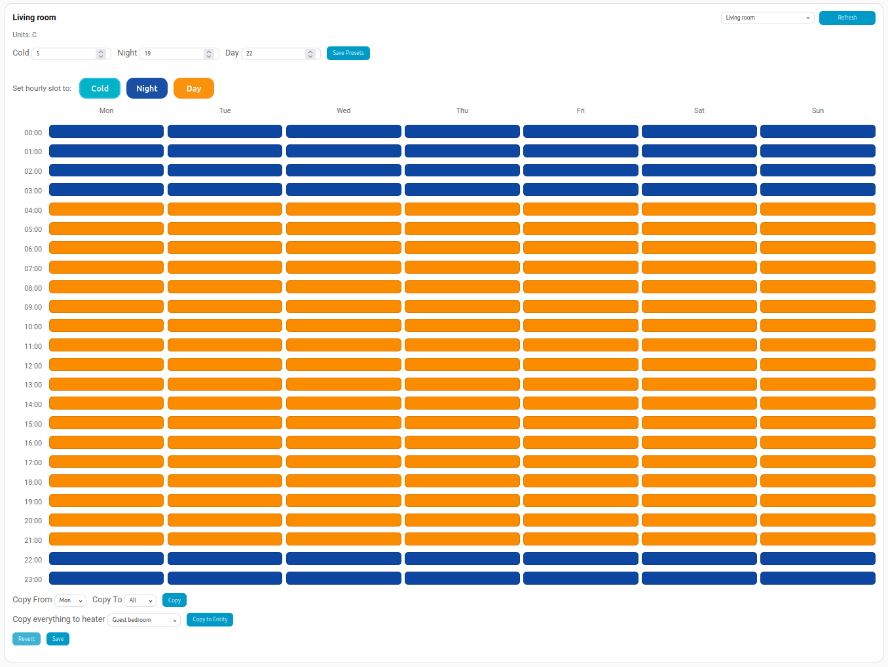

[](https://hacs.xyz/)


[](LICENSE)
[](https://github.com/ha-termoweb/ha-termoweb/releases)

[](https://github.com/ha-termoweb/ha-termoweb/actions/workflows/tests.yml)


[](https://docs.astral.sh/uv/)
[](https://docs.astral.sh/ruff/)


# TermoWeb heaters for Home Assistant

Control your **TermoWeb**, **Ducaheat**, or **Tevolve** electric heaters and thermostats in **Home Assistant** — from the HA app, automations, scenes, and voice assistants.

**New: no cloud needed.** With a small 868 MHz radio (a USB stick or a home-built gateway), Home Assistant talks to your heaters directly. See [Local-first](#local-first-no-cloud-no-vendor-gateway).

[](https://my.home-assistant.io/redirect/hacs_repository/?owner=ha-termoweb&repository=ha-termoweb&category=integration)
[](https://my.home-assistant.io/redirect/config_flow_start/?domain=termoweb)


> You must install the integration first (via HACS or manual copy) before the “Add integration” button will work.

---

## Who is this for?

For someone who runs Home Assistant and has **TermoWeb**, **Tevolve** or **Ducaheat** family electric heaters. They want to see and control those heaters in Home Assistant, use automations, and enable voice control. The manufacturer’s app doesn’t integrate with HA — this integration provides the missing link.

You can connect in two ways:

- **Local radio (recommended):** no cloud, no account, no vendor gateway. See the next section.
- **Cloud account:** you already use the TermoWeb, Tevolve or Ducaheat app with the vendor's Wi-Fi gateway.

---

## Local-first: no cloud, no vendor gateway

Your heaters talk to each other over a small **868 MHz radio**. Normally the vendor's Wi-Fi gateway listens to this radio and sends everything to the vendor's cloud. The app then talks to the cloud.

With a **local radio**, Home Assistant talks to your heaters **directly**. Nothing goes through the internet.

**Why local?**

- **Private.** No cloud account. Your heating data, temperatures and times when you are at home stay in your home.
- **Cheaper.** The vendor's Wi-Fi gateway costs **at least about €130**. A nanoCUL USB stick costs about **€25 to €60**. A home-built ESP32 gateway costs about **€20 to €40** in parts.
- **Works without internet.** Your heaters keep working in Home Assistant when your internet or the vendor's cloud is down.
- **Direct.** Changes go straight to the heater, not through a server on the internet.

**Choose your radio:**

| | Vendor Wi-Fi gateway + cloud | nanoCUL USB stick | ESP32 + CC1101 gateway |
|---|---|---|---|
| Cost | at least about €130 | about €25 to €60 | about €20 to €40 (parts) |
| Soldering | no | no | yes, a little (antenna, sometimes pins) |
| Internet needed | yes, always | no | no (only your home Wi-Fi) |
| Account needed | yes | no | no |
| Privacy | data goes to the vendor's cloud | stays at home | stays at home |
| Setup effort | easy (app + sign in) | easy: put our firmware on the stick once, in your browser (about 10 min), plug in | advanced: wiring, soldering, put our firmware on the board in your browser (1 to 2 hours) |
| Where it sits | next to your router | in a USB port of the Home Assistant computer | anywhere with Wi-Fi and power |
| Guide | below: [Set up the integration](#set-up-the-integration) | [Radio stick: use a nanoCUL USB stick](docs/radio_nanocul.md) | [Radio gateway: build your own with an ESP32](docs/radio_gateway.md) |

Prices checked on 2026-10-11 at European shops. They change. The guides list shops and current prices.

**Which one should I pick?**

- You want it simple, and you do not want to solder: take the **nanoCUL USB stick**.
- Your Home Assistant computer is far from the heaters: take the **ESP32 gateway**. It only needs Wi-Fi and a USB power supply, so you can put it in a central place.

Both radios work with the same heaters. You do not need to know how your heaters talk: the setup finds out by itself.

**How to start with a local radio:**

1. **Buy** the hardware. The guides list what to buy and where.
2. **Put our firmware on it.** Everyone does this once: no shop sells the stick or the board with our firmware on it. The easiest way is in your web browser (Chrome or Edge), with a few clicks. The guides show every step.
3. **Plug it in.** The nanoCUL goes into a USB port of the Home Assistant computer. The ESP32 gateway needs a USB power supply and your Wi-Fi.
4. **Add it in Home Assistant** (see [Set up the integration](#set-up-the-integration)). Your heaters are then found by themselves.

**Good to know:**

- The local radio is tested with **ATC Sun Ray** heaters. Other heaters on the TermoWeb 868 MHz radio may work. Ducaheat and Tevolve heaters are not tested over the radio yet.
- Setup is automatic. Home Assistant finds the ESP32 gateway by itself and pre-selects the nanoCUL port. Heaters pair by themselves within 30 minutes of adding the radio, or after you press **Pair new heaters**. Each heater's power is read from the heater. You do not type a network id.
- You can keep the vendor's gateway, or remove it. Without it, the vendor's app no longer works.
- Some cloud features do not exist on the radio, for example the **energy history import** (the heaters store no history). Energy is **estimated** from each heater's power and heating time. See [what works over the radio](docs/radio_backend.md#cloud-features-and-what-radio-users-see).
- The radio **transmits** on 869.525 MHz (European short-range-device band, about 10 mW). You are the operator of the transmitter. See the [radio notice](docs/radio_gateway.md#radio-notice).
- Want the technical details of the heaters' radio? See [docs/radio_protocol.md](docs/radio_protocol.md).

---

## Brands using the TermoWeb app

These product lines are documented to work with the **TermoWeb** portal/app:

- **ATC (UK/Ireland)**: **Sun Ray Wifi** radiators with Wifi gateway. (**verified and fully working**)
- **S&P — Soler & Palau**: “**TermoWeb**” kits and **EMI-TECH TermoWeb** radiators.
- **Ecotermi / Linea Plus**: **Serie TermoWeb** radiators.
- **EHC — Electric Heating Company**: **eco SAVE** Smart Gateway kits that register on the TermoWeb portal.

> If a brand isn’t listed but the user signs in at **control.termoweb.net** (or **control2.termoweb.net**) with an app called **TermoWeb**, this integration should work.

## Ducasa with Ducaheat app.

Ducasa branded heaters (with the Ducaheat app), accumulators and other devices, are now supported with basic functionality tested and working. Heaters support temperature setting, weekly programming, switching modes (auto, manual, off). Preliminary support for "boost" on accumulators is currently in testing. Energy and power readings are also in testing with some basic support. Work is ongoing with full support expected before the end of the year. 

## Tevolve app (Ducaheat backend)

Tevolve-branded heaters use the same backend as the Ducaheat app. If you manage your heaters in the **Tevolve** mobile app or on the **Tevolve** website, select **Tevolve** in the brand picker and this integration will connect using the Ducaheat backend automatically.

---

## What you can do in Home Assistant

- Turn heaters and thermostats **On/Off** and set **target temperature**.
- Choose **Auto** or **Manual** mode.
- See live room temperature and heating state (every heater is also a temperature sensor)
- View and change the weekly schedule and temperature presets
- See cumulative energy use and import energy use history from TermoWeb.
- Add energy sensors to the HA energy dashboard so you can see current and historical use/cost.
- Monitor thermostat battery level so you know when wireless controllers need attention.
- Track accumulator charging status and charge targets to understand storage heater behaviour.
- With a local radio, on heaters that support it: start a **boost** (choose the **Boost** preset on the heater), and switch **Runback** and **EASY mode** on or off. The boost uses the heater's own boost time. Turning Runback off gives the heater back its mode and temperature from before.
- With a local radio: change a heater's **advanced settings** (open the heater device, section **Configuration**): **Temperature offset** (−3.0 to +3.0 °C), **Control mode** (PID or hysteresis), **Panel temperature unit** (°C or °F on the heater's own display), **Open window detection** and **True radiant**. The heater cannot report these settings, so each one shows **Unknown** until you set it in Home Assistant, and a change made on the heater's panel is not shown. When you set one, the others are sent as shown (unknown ones as the factory defaults).
- Use HA **automations**, **scenes**, and **voice assistants** (including HA’s Google/Alexa integrations).

### Climate mode behavior (important)

Use these rules when changing heater temperature in Home Assistant:

1) If the heater is in **Auto** and you change the target temperature, Home Assistant sends a **temporary override**.
2) That temporary override runs until the next weekly program time slot starts.
3) After that, the heater returns to the normal weekly **Auto** program temperature.
4) The heater switches to **Manual/Heat** only when you explicitly select **Heat** (manual) mode in Home Assistant.

If your dashboard shows a preset label, **temporary override** means: “Use this manual target now, but only until the next scheduled program change.”

---

## What you’ll need

- Home Assistant **2026.10.0 or newer** (Core, OS, or Container). HACS will not install the integration on an older version. Update Home Assistant first.
- One of these:
  - **Local radio (no cloud, recommended):** a nanoCUL USB stick (easiest, no soldering) or a home-built ESP32 radio gateway (advanced). No account, no vendor gateway, and no internet access needed. See [Local-first](#local-first-no-cloud-no-vendor-gateway).
  - **Cloud account:** a working TermoWeb setup (vendor gateway connected to the router, heaters paired) and the **account email & password** (the same used in the mobile app / web). Home Assistant needs internet access.

---

## Cloud or local: what to expect

- With a **cloud account**, the integration **depends on the internet**: all interaction with the heaters goes through the vendor's cloud. The vendor's Wi-Fi gateway is a closed "black box", so Home Assistant cannot talk to it directly. If the cloud is down, your heaters show **unavailable** in Home Assistant.
- With a **local radio**, Home Assistant talks to the heaters directly. No internet, no cloud. A few cloud-only features are missing: see [Local-first](#local-first-no-cloud-no-vendor-gateway).

---

## Install (simple, step-by-step)

### Option A — HACS (recommended)

1) Open **HACS → Integrations** in Home Assistant.  
2) Click **⋮** (top-right) → **Custom repositories** → **Add**.  
3) Paste: `https://github.com/ha-termoweb/ha-termoweb` and choose **Integration**.  
   Or click:  
   [](https://my.home-assistant.io/redirect/hacs_repository/?owner=ha-termoweb&repository=ha-termoweb&category=integration)  
4) Search for **TermoWeb** in HACS and **Install**.  
5) **Restart Home Assistant** when prompted.

### Option B — Manual

1) Download this repository.  
2) Copy the folder **`custom_components/termoweb`** to **`<config>/custom_components/termoweb`** on the HA system.  
3) **Restart Home Assistant**.

---

## Set up the integration

1) In Home Assistant go to **Settings → Devices & Services → Add Integration** and search **TermoWeb**,
   or click:
   [](https://my.home-assistant.io/redirect/config_flow_start/?domain=termoweb)
2) Choose how your heaters connect:
   - **Local radio: nanoCUL USB stick** (easiest, no soldering): you have a nanoCUL with our `termoweb_rx` firmware on it (see [step 2 of the nanoCUL guide](docs/radio_nanocul.md#step-2-put-the-termoweb_rx-firmware-on-the-stick)), plugged into the Home Assistant computer.
     The stick is usually already selected. Follow [Radio stick: use a nanoCUL USB stick](docs/radio_nanocul.md), step 4, then go to step 6.
   - **Local radio gateway** (advanced, needs soldering): you built the ESP32 radio gateway and put our firmware on it (see [step 4 of the ESP32 guide](docs/radio_gateway.md#step-4-put-the-firmware-on-the-esp32)). You usually do not need this menu:
     Home Assistant finds the gateway by itself and shows it under **Discovered**. Follow
     [Radio gateway: build your own with an ESP32](docs/radio_gateway.md), step 6, then go to step 6.
   - **Cloud account**: you use the TermoWeb, Ducaheat or Tevolve app with the vendor's gateway. Go to step 3.
3) Choose your **Brand**. This picks the correct backend automatically, so you do **not** need to enter a portal URL manually.
4) Enter the account **Email** used for the TermoWeb / Ducaheat / Tevolve app.
5) Enter the account **Password**.
6) Complete the wizard. Heaters will appear under **Devices**; add them to dashboards or use them in automations.
   With a local radio, setup finishes at once. The integration then finds your heaters in the background and adds each one
   by itself, usually within a few minutes. You get a notification for each heater it finds.
   New heaters pair by themselves: put the heater into pairing mode within 30 minutes of adding the gateway,
   or press **Pair new heaters** on the gateway device first. Pairing is then open for 10 minutes.
7) Optional: add the **TermoWeb Schedule** card to a dashboard to edit each heater's weekly schedule and preset temperatures. There is nothing to install. See [Schedule card: edit the weekly schedule](docs/schedule_card.md).
---

## After the upgrade (2026-10 release)

What changed, and what you need to do:

- **Home Assistant 2026.10.0 or newer is required.** Update Home Assistant first, then update the integration in HACS. Restart Home Assistant when asked.
- **Your entities are kept.** On the first start, the integration moves all entities to one new ID scheme by itself. Entity IDs (for example `climate.living_room`), history, names, areas and dashboards stay the same. You do not need to do anything.
- **One unavailable duplicate?** Some people have an old, unavailable entity left over from version 2.3.0 (for example a second **Installation info** sensor). Delete the one that shows **unavailable**:
  1. Go to **Settings → Devices & Services → Entities**.
  2. Search for the name, for example `installation info`.
  3. Open the entity that says **unavailable** or **no longer provided by the integration**.
  4. Click the **gear** icon, then **Delete**.
  Keep the entity that has a value.
- **Temperatures in °F** are now shown correctly for devices that use Fahrenheit.
- **Turn on and turn off** now work from the climate card, automations and voice assistants.
- **Unavailable when the cloud is down.** If the TermoWeb cloud cannot be reached, your entities show **unavailable** instead of old values. They come back by themselves when the cloud is back.
- **Boost (accumulators).** Boost can last 60 to 600 minutes (in steps of 60). The boost buttons work again. The boost duration and boost temperature numbers now save to the device.
- **Removed:** the `ws_debug_probe` action and the **debug** option. To collect logs, see [DEBUG.md](DEBUG.md).
- **Radio heaters are named by serial number.** With the nanoCUL stick or the ESP32 radio gateway, a heater was called "Heater 2", from its radio number. That number depends on the pairing order and can change. Now each heater is called by its serial number, for example **Heater X123456**. When you pair a heater again, it keeps its device, entities and history.
  - On the first start, the integration asks each heater for its serial number. A heater that does not answer keeps its old name until a later start.
  - Your entity IDs stay the same (for example `climate.heater_2`). Home Assistant never renames entity IDs by itself. To change one, open the entity, click the **gear** icon and edit the **Entity ID**.
  - A name you gave the device yourself is kept.
  - To see a heater's radio number, enable its **Radio address** sensor: open the device, click **Radio address** under **Diagnostic**, click the **gear** icon, and turn on **Enabled**.

### Your password changed

If you change your password in the TermoWeb, Ducaheat or Tevolve app, Home Assistant cannot sign in any more. Then:

1. Open **Settings → Devices & Services**. The TermoWeb card asks you to sign in again. A message also appears in **Settings → Repairs**.
2. Click it and enter the **new password**.
3. The integration reloads by itself. You do not need to remove it.

Changing the settings with **⋮ → Reconfigure** also reloads the integration for you.

### One account, one entry

You can add each account only once. The same email on **Ducaheat** and **Tevolve** counts as the same account, because both use the Ducaheat backend. Upper and lower case in the email do not matter. If you try to add it again, Home Assistant says it is already configured.

### Why the integration is careful with the cloud

The cloud is shared by many users. To protect it, the integration:

- uses the **WebSocket** (live push) for updates once it has started. It asks the cloud over REST only when the WebSocket is not available.
- sends at most **2 cloud requests per second**, also during the energy history import.
- waits a short time before it tries to reconnect after an outage.

Please do not add automations that call the cloud very often.

---

## Tips
- **Voice control:** Expose heater entities via Home Assistant’s Google or Alexa integrations.
- **Automations idea:** Lower temperature when nobody’s home; switch to **Off** if a window sensor is open for 10+ minutes.

## Weekly schedule card

The integration includes a dashboard card for the weekly schedule and the preset temperatures. It comes with the integration, so there is nothing to copy or install. To add it: edit a dashboard, click **+ Add card**, open the **By card** tab, search for `termoweb` and pick **TermoWeb Schedule**. See [Schedule card: edit the weekly schedule](docs/schedule_card.md).




## Energy monitoring & history
- Each heater provides an **Energy** sensor in kWh and the integration adds a **Total Energy** sensor aggregating all heaters.
- Add these sensors in **Settings → Dashboards → Energy** to include them in Home Assistant’s Energy Dashboard.
- Live energy samples now arrive via the websocket connection, with the hourly
  REST poll remaining as a fallback if the push feed is unavailable.
- With a local radio (nanoCUL stick or ESP32 gateway), the **Energy** sensor works too. Some heaters
  keep their own energy meter: the integration reads it every 10 minutes, so the sensor
  shows the same total as the heater. Other heaters have no meter: the integration
  estimates their energy from the heater power and heating time. An estimate starts at 0 when
  Home Assistant starts. Past use cannot be imported over the radio.
- Use the `termoweb.import_energy_history` action (Developer Tools → Actions) to add past consumption after installing the integration. **Run it once.** Most people never need to run it again.
  1. Set **Max history days** to how far back you want (1 to 3650, default 7).
  2. Run the action. It imports every heater, accumulator and power monitor that has an energy sensor. It asks the cloud for one day per request, at most 2 requests per second, so a year for 3 heaters takes about 10 minutes. Do not start it twice. A second run while one is active stops with "already running".
  3. If it stops with an error, run it again later. It continues where it stopped.
  4. To get more days later, run it again with a bigger number. Only the missing older days are fetched.
  5. To import the whole period again, turn on **Reset progress**. The old statistics are overwritten in place. Nothing is deleted.
- What you will see: in **Settings → Dashboards → Energy**, the past days fill in with hourly values. The totals continue without a jump at the point where the import ends. The numbers can take a few minutes to show after the import ends.
- No extra configuration is required beyond selecting the sensors in the Energy Dashboard.
- **With a local radio:** energy is **estimated** from each heater's power and the time it heats (within a few percent of a house meter in our tests). It starts at 0 when Home Assistant starts. There is no history to import: the heaters do not store it, so the import action does nothing on the radio.

---

## Troubleshooting

**Local radio (nanoCUL or ESP32):**

- **No heater is found:** Turn one heater's temperature up so that it starts heating. Move the radio closer to a heater. Check that your radio is the **868 MHz** version. Or pair the heater: press **Pair new heaters** and put the heater into pairing mode.
- **"The firmware on this nanoCUL stick is too old":** put the new firmware on the stick. See [step 2 of the nanoCUL guide](docs/radio_nanocul.md#step-2-put-the-termoweb_rx-firmware-on-the-stick).
- **More help:** see troubleshooting in the [nanoCUL guide](docs/radio_nanocul.md#troubleshooting) and the [ESP32 guide](docs/radio_gateway.md#troubleshooting).

**Cloud account:**

- **Login fails:** First confirm credentials at the TermoWeb website (control.termoweb.net / control2.termoweb.net).
- **No devices found:** Check the **gateway** is powered and online (LEDs), and that the manufacturer app shows heaters online.
- **Slow reconnect after errors:** Websocket retries are rate limited to protect the backend. A brief pause between attempts is
  expected after any outage.
- **Login fails after a password change:** See **Your password changed** above.
- **Entities show unavailable:** The cloud may be down, or your gateway is offline. Check the manufacturer app. They return by themselves.
- **Collect diagnostics:** In **Settings → Devices & Services → TermoWeb → ⋮**, choose **Download diagnostics** to save an anonymised report (integration/Home Assistant versions, backend brand, node inventory; account, gateway id and location are removed). Attach that JSON file when opening an issue so we can reproduce problems faster.
- **Need help?** Open a GitHub issue with brand/model and a brief description. **Never share passwords or private info.**

---

## Privacy & Security

- **Local radio:** no account, no cloud. Nothing about your heaters leaves your home network.
- **Cloud account:** credentials stay in Home Assistant. Access tokens are **redacted** from logs. The vendor's cloud still sees your heater data, because the vendor's gateway sends it there.
- Diagnostics downloads remove your account, gateway id and location.
- This project is **not affiliated** with S&P, ATC, Ecotermi/Linea Plus, EHC, or TermoWeb.

---

## Development

Setup your environment:

```bash
uv sync --locked --extra test
```

All tests run against the real Home Assistant (folder `tests/`). One command
runs them and checks the 95% coverage gate. Tests run in random order and any
warning fails the run:

```bash
timeout 120s uv run pytest --cov
```

Code style is checked in CI with a pinned Ruff. Run both commands before you commit:

```bash
uv run ruff format custom_components tests
uv run ruff check custom_components tests
```

See [`docs/developer-notes.md`](docs/developer-notes.md) for backend write semantics and other
implementation details for contributors.

---

## Debugging and Logs

See DEBUG.md for information on how to turn on debugging, and download logs and diagnostics.


## Contributors

Thank you to everyone who made this integration possible.

| Who | Contribution |
|---|---|
| [Andrew Morgan (@morganand)](https://github.com/morganand) | Maintainer. Cloud integration, radio backend, testing on real heaters. |
| [Andre Faria (@andremmfaria)](https://github.com/andremmfaria) | Author of [ha-termoweb-local](https://github.com/ha-termoweb/ha-termoweb-local): the original work on the heaters' 868 MHz radio protocol, the `termoweb_rx` nanoCUL firmware and the first local-radio integration. The radio backend and nanoCUL firmware in this repository build on that work. |
| [@harsh04081997](https://github.com/harsh04081997) | Code contributions to the cloud integration. |
| [Anthropic Claude](https://www.anthropic.com/claude) | AI assistant: code writing, code review, testing and research. |
| [OpenAI Codex](https://openai.com/codex/) | AI assistant: code writing and research. |

Want to help? Bug reports, heater captures from other brands and pull requests are welcome. See [Development](#development).

## Search keywords

*Home Assistant TermoWeb, TermoWeb heaters Home Assistant, ATC radiators, S&P TermoWeb Home Assistant, Soler & Palau TermoWeb, Ecotermi TermoWeb, Linea Plus TermoWeb, Electric Heating Company eco SAVE Home Assistant, eco SAVE Smart Gateway Home Assistant, TermoWeb without cloud, TermoWeb local control, nanoCUL 868 TermoWeb, ESP32 CC1101 868 MHz heaters, Sun Ray heaters local*
