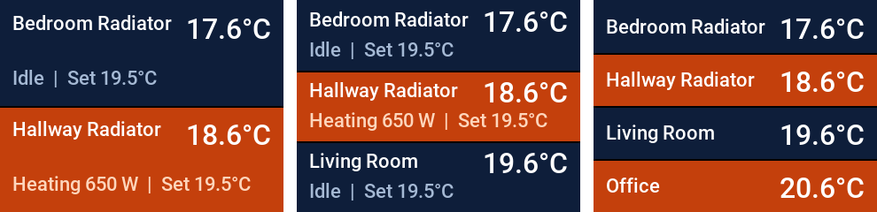
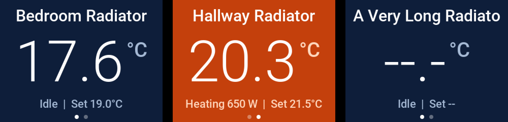

# CoreS3 SE gateway with touch screen

An alternative to `../termoweb-radio.yaml` for the **M5Stack CoreS3 SE** with the **Module CC1101**. It adds a screen with two kinds of view. Tap the screen to step through them:

1. **All heaters** in one condensed view, one row per heater (up to 4). Each row has its own background, which turns orange while that heater is heating.
2. **One heater per page**: name, temperature, set point, heating state. A tap shows the next heater, then returns to the condensed view.

The screen needs the integration installed from this fork (see the main README, option A), because the integration sends the heaters to the screen.

## Setup

1. Set the Module CC1101 DIP switches to **CSN=G5, GD00=G7, GD02=G10**.
2. Copy these files into one ESPHome folder: `termoweb-radio-cores3.yaml`, `cores3_display.h`, `cores3_gfx.h`, `cores3_font.h` and `../termoweb_radio.h`.
3. Add `wifi_ssid`, `wifi_password` and `api_encryption_key` to `secrets.yaml`.
4. Install, then adopt the new device in Home Assistant (Settings → Devices & services → ESPHome).

## Home Assistant controls

On the **ESPHome** device (not the TermoWeb device):

- **Screen brightness**: 0 to 100 %, 0 switches the backlight off. Saved across reboots.
- **Screen invert colours**: flip it if the colours look wrong.

## Notes

- `radio_frequency_khz` stays at 869525 unless a heater never acknowledges commands. A heater whose receiver sits slightly low may need about 869475 to 869490. To find the range, set the frequency live with `F<kHz>` (for example `F869490`) and check that each heater acknowledges; the value is lost on reboot, so then set the substitution and reflash.
- The screen shares the radio's SPI bus and is only drawn while the receiver is idle, so it cannot disturb a radio frame.
- The TermoWeb integration sends every heater to the screen (name, temperature, set point, power, heating) after each refresh, so there are no entity names to configure. Up to 4 heaters are shown, one page each. The integration only does this for firmware that reports `display=on`.
- `gen_font.py` regenerates `cores3_font.h` from the Roboto fonts (Apache 2.0): `python3 gen_font.py Roboto-Medium.ttf Roboto-Light.ttf > cores3_font.h`.
